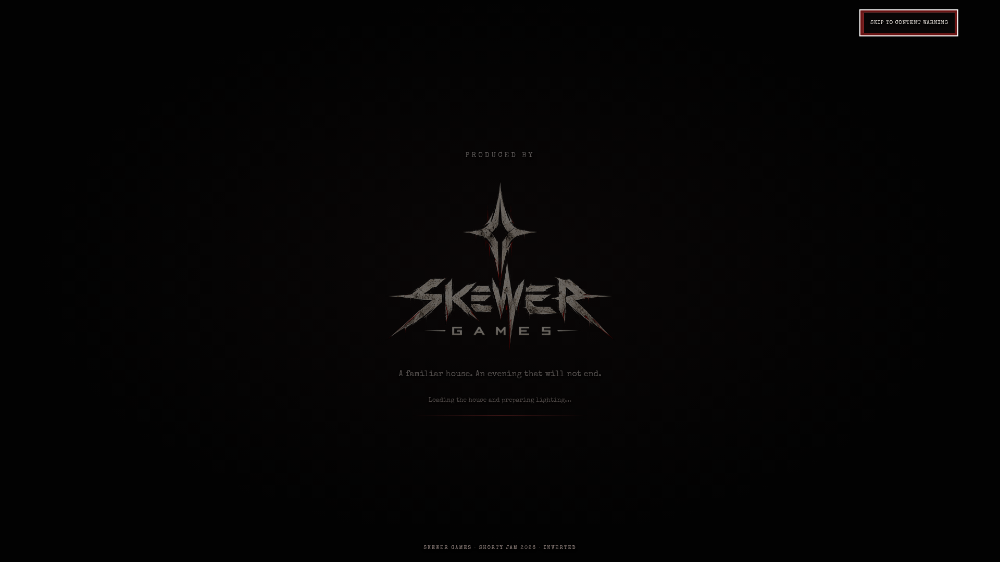
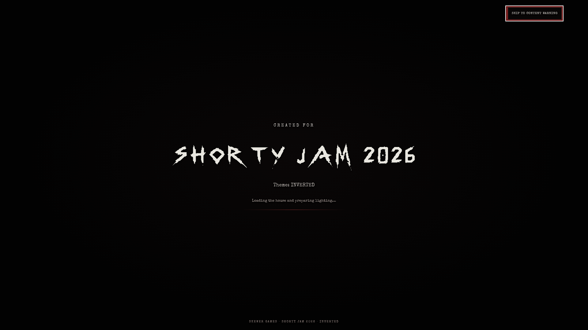
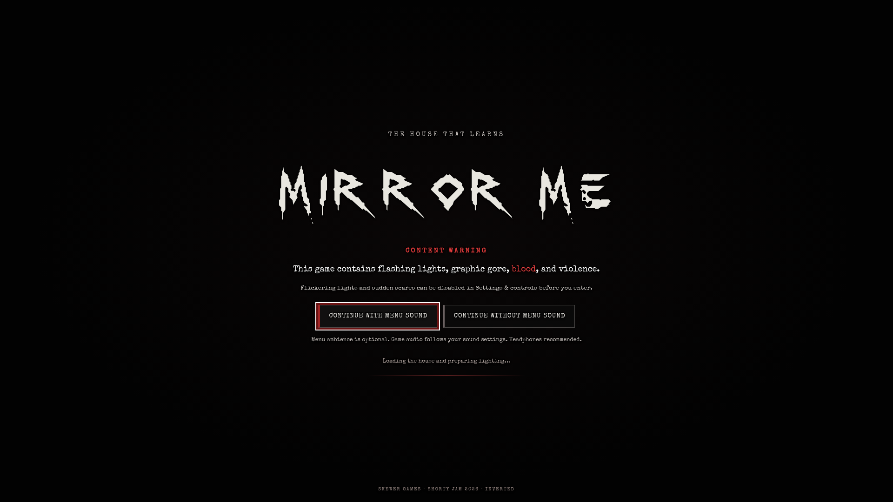
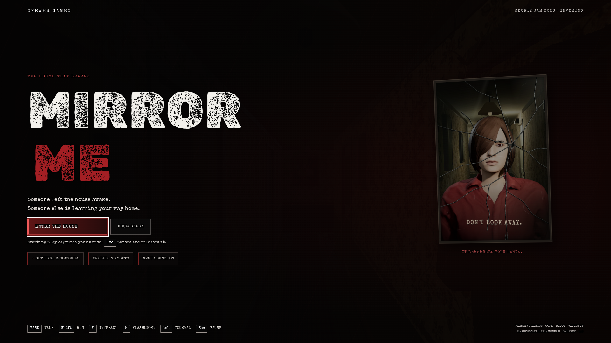
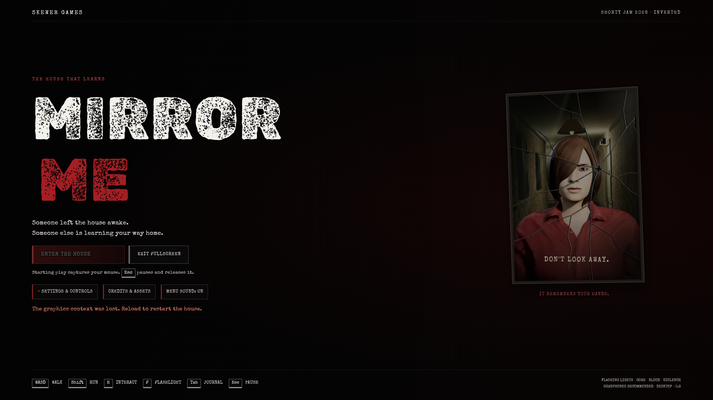

# MIRROR ME — Cloudflare Pages playtest

**Later measured follow-up:** see [rendering and input diagnosis](MIRROR_ME_RENDERING_DIAGNOSIS.md). Subsequent testing captured the hallway and verified forward displacement, but measured only approximately 3 FPS. The initial attempt record below is retained for chronology.

**Result: loading, menu, fullscreen, and pointer lock observed; visible first-person navigation could not be established. No independent playthrough is claimed.**

Date: 2026-10-25, approximately 08:24–08:33 UTC. Target: https://mirror-me.pages.dev/. This separately authorized fallback test preserves the original itch.io failure report. No further itch.io access attempts were made.

## Release equivalence

The fetched Pages `/` HTML has SHA-256:

`5b147e9fd47cbb1711ec16ebe7108b2aa2962143e7e229f294c32c52bd7cbbb0`

It is byte-for-byte identical to the existing repository `index.html`. The fetched HTML references `src/intro.mjs`, `src/menu-mirror.mjs`, and `src/main.mjs`; no unique release identifier was found in its metadata. The visible menu footer says `DESKTOP · 0.8`.

**Exact equivalence to the published itch.io release cannot be established.** There is no accessible published itch.io artifact or manifest/hash to compare. Matching one entry document to the working repository does not establish matching JavaScript, assets, or the uploaded itch.io build. Repository filenames were checked for available release manifests/artifacts, without reading gameplay solutions. No walkthrough, chapter constants, game logic, or automated route was consulted. These observations apply to Pages only.

## Environment and method

Playwright controlled real, headed `/usr/bin/chromium` on Xorg dummy display `:98`, with a 1920 × 1080 desktop viewport. No headless fallback was used for this Pages test. No game files, deployed content, timers, chapter state, or progression were modified. Browser metadata and visible DOM were inspected for focus, fullscreen, lock, button state, and error messages. Input monitoring added only DOM event listeners, not game-state changes.

The environment proxy certificate was imported into browser trust so HTTPS verification could remain enabled. Chromium initially attempted ANGLE/Mesa llvmpipe. WebGL context creation failed (`BindToCurrentSequence failed`), and the game displayed a hardware-acceleration recommendation. This was already software rendering, not a physical gaming GPU.

A subsequent headed launch explicitly used ANGLE SwiftShader. CDP reported `ANGLE_SWIFTSHADER`, `SwiftShader Device (Subzero)`, and `hardwareSupportsVulkan: false`. WebGL creation succeeded. Actual audio was not captured or monitored; selecting menu sound is not evidence of audible output. No audio-quality assessment is made.

Initial captures ran serially at a requested one-second interval, but screenshot/render delays substantially increased actual intervals. This added overhead, so the last fresh attempt closed earlier browsers and removed continuous capture. Software-rendering delays here cannot establish normal gaming-hardware performance.

## Loading and attempt timeline

| Approximate UTC | Direct observation |
| --- | --- |
| 08:24:30 | First Pages document loaded; studio splash visible |
| 08:24:40 | Shorty Jam 2026 / INVERTED splash captured |
| 08:24:47 | Content warning captured after natural splash progression; WebGL startup had failed |
| 08:26 | Relaunched headed Chromium with SwiftShader; studio sequence allowed to run again |
| ~24 seconds into SwiftShader attempt | Content warning visible; game still said “Preparing your view…” |
| ~55–60 seconds into SwiftShader attempt | Continued through warning using its sound-enabled UI; main menu ready with Enter the house available |
| ~08:27–08:28 | Fullscreen entered through game button; document fullscreen element `HTML`; canvas backing size and CSS size both 1920 × 1080; focus true |
| 08:28:16 | Console recorded `CONTEXT_LOST_WEBGL`, then “Background room preparation: WebGL context lost while preparing a room” |
| 08:28:20 | Console reported context restored; UI nevertheless displayed “The graphics context was lost. Reload to restart the house.” Enter the house disabled |
| 08:28:43 | Fresh SwiftShader attempt loaded, earlier browsers closed, continuous screenshots removed |
| +12 seconds | Studio splash still present |
| +22 seconds | Content warning visible |
| +~50 seconds | Ordinary coordinate click continued with menu sound |
| +~59 seconds | Menu interactive, Enter the house enabled |
| ~08:29–08:30 | Fullscreen confirmed again, 1920 × 1080 and focus true |
| 08:30:10 | Ordinary click on Enter the house acquired pointer lock: `document.pointerLockElement` was `CANVAS`, fullscreen `HTML`, focus true |
| After entry | Starting-view screenshot exceeded its 15-second timeout after font readiness; no starting hallway image obtained |
| Final control attempt | Requested meaningful mouse moves and a three-second W hold; diagnostic request timed out without returning input-event or rendered-view evidence |

On the first run the entire automatic splash-to-warning transition was observed within approximately 17 seconds. Screenshots establish studio first and jam second; individual fade boundaries were not instrumented, so separate exact stage durations are unavailable. On software-rendered retries the studio remained visible at 12 seconds and the warning was visible by 22–24 seconds. Menu readiness took longer, approximately a minute in the measured retries. Screenshot overhead and automation delays affect these bounds.

No Skip button was used, no splash was clicked away, and no timer was accelerated. Content warning confirmation was used only after the automatic splashes completed. The loading sequence's benefit to initial gameplay responsiveness remains unverified because responsive gameplay was never established.

## Fullscreen and controls

Fullscreen was activated through the game's own button after the menu appeared. Success was verified by the DOM fullscreen element, 1920 × 1080 viewport and canvas, focus, and button text changing to Exit fullscreen. It remained enabled during the final entry/control attempt.

Pointer lock **was acquired**, rather than inferred from a click. This is meaningful progress over the earlier failed test. Nevertheless, pointer lock alone does not establish usable mouse-look.

The requested mouse path moved toward screen center and then 300 pixels horizontally in six steps. The subsequent W test requested three seconds of sustained input. The remote diagnostic request did not return usable evidence before timeout. No before/after hallway landmarks or camera rotation were visible to compare. These inputs therefore cannot be marked successful, and their full delivery cannot be confirmed. The attempted DOM input-event log likewise did not return.

There was no iframe on this direct Pages test. Focus and fullscreen were explicitly true. Rendering delays and WebGL instability are observed limitations; an underlying game-input bug or a relative-mouse-input incompatibility is **not established**. A starting-view capture failed even before visual navigation comparison was possible.

A/S/D, E, F, Tab, Escape pause/resume, and Shift sprint were not independently verified. Puzzle interaction did not begin. The test stopped at the navigation-verification gate rather than substituting scripted progression.

## Chapter record

| Stage | Measured gameplay time | Independent observations |
| --- | --- | --- |
| Chapter 1 | No verified gameplay interval | Entry clicked and canvas pointer lock acquired; hallway, objective, movement, and puzzle interaction not visually established |
| Chapter 2 | Not reached | No exploration, clues, guesses, narrative, or chapter time |
| Chapter 3 | Not reached | No observations |
| Chapter 4 | Not reached | No observations |
| Chapter 5 | Not reached | No observations |
| Chapter 6 | Not reached | No observations |
| Chapter 7 | Not reached | No observations |
| Ending / funeral / credits | Not reached | No observations; no sequence skipped |

There were no puzzle attempts or incorrect guesses. No creatures, environmental transformations, major puzzles, story reveal, funeral, or credits were observed. The chapter count and requested landmarks originate in the brief, not independent discovery.

## Evidence screenshots

The portrait reflected in the menu is menu artwork/animation, not evidence of a gameplay creature encounter. No unvisited area is illustrated.

## Findings and severity

| ID | Severity for this test | Evidence and limits |
| --- | --- | --- |
| CF-01 | Blocker | Initial llvmpipe context creation failed; game clearly reported that WebGL could not start. Environment/rendering incompatibility; no normal-GPU reproduction |
| CF-02 | Blocker | SwiftShader run lost its graphics context during background room preparation; UI required reload and disabled entry. Console later reported restoration, but UI remained blocked. Reproduced once; cause not isolated |
| CF-03 | Blocker for independent evaluation | Fresh run acquired lock but starting screenshot timed out and control diagnostic yielded no visible navigation evidence. Software rendering/browser automation limitations prevent a reliable playthrough claim |
| CF-04 | Minor usability observation | Warning/menu status uses small, subdued text on a very dark background; loading status is much less prominent than title art. This may be hard to read at a distance; no formal contrast measurement performed |

No confirmed ordinary-player movement bug is reported. The context-loss recovery behavior merits testing on supported hardware, but this environment cannot establish its prevalence.

## Critical assessment of what was reached

The menu has a coherent horror presentation: distressed white/red typography, a dark brown-red environment, and a cracked mirror framing a woman's face. The cracked reflection communicates the central motif before play. The layout separates entry, fullscreen, settings, credits, and sound controls clearly. At 1080p the large title dominates, while explanatory and status text is comparatively small. The failure message is actionable and visible, though its low placement makes it less prominent than the title and portrait.

The content warning is explicit about flashing lights, graphic gore, blood, and violence. It advertises controls to disable flicker and sudden scares and offers menu-sound choice before entry. These are useful accessibility affordances as presented, but the settings' actual effectiveness, subtitle support, remapping, comfort options, and in-game readability were not tested.

No defensible judgment can be made about movement feel, puzzle fairness, exploration feedback, pacing, gameplay visual consistency, creature animation, mirror transformations, suspense escalation, narrative motivation/reveal, or ending. Audio is unassessed. No emotional reaction or overall game score is fabricated. The front end presents a clear visual identity, but this test did not produce the gameplay evidence needed to judge MIRROR ME as a complete horror game.

## Scope and handoff

Direct observations: public Pages splash/menu, visible warnings, successful fullscreen, canvas pointer lock, context loss, and capture/diagnostic timeouts. Assisted progression: none. Source-derived solutions: none. Source-derived information is limited to hashing the repository entry HTML and listing possible artifact filenames. Unverified assumptions include exact itch.io equivalence, actual input processing, chapter content, and hardware performance.

The specific stopping condition is inability to obtain a stable rendered first-person view for control verification in this software-rendered environment, despite a fresh headed retry with reduced capture load. A hardware-backed headed Chromium environment is needed for the next useful attempt. The original itch.io report is unchanged. This branch contains review documents and screenshots only; no game change, merge, or deployment was performed.
