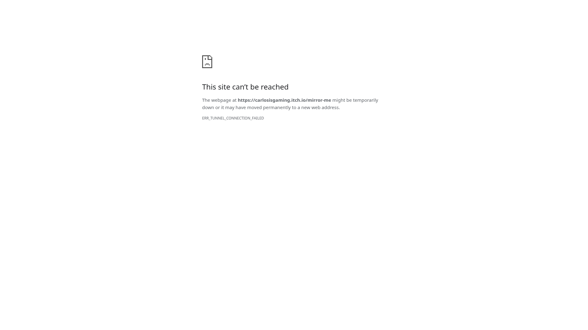

# MIRROR ME — live itch.io playtest attempt

**Result: blocked before the itch.io page loaded. No independent playthrough or critical game review was possible.**

Test date: 2026-10-25, approximately 08:19–08:22 UTC. Target: https://carlosisgaming.itch.io/mirror-me. Repository: Skewernet/Mirror-Me---Shorty-Game-Jam. This report concerns this new attempt only; no previous test observations were reused.

## Method and environment

Playwright controlled installed `/usr/bin/chromium`. A headed browser successfully launched on virtual Xorg display `:98` using the dummy driver, with a 1920 × 1080 page viewport. No physical display was present. Xvfb was unavailable; Xorg with its installed dummy driver was the available alternative. Initial Xorg and browser launches failed under socket restrictions. Retrying with the execution tool's additional network permission allowed the X server and headed browser to run.

GPU acceleration was not explicitly disabled in the successful launch. Playwright's unsafe SwiftShader opt-in was removed. Actual GPU acceleration was not verified, and a dummy display does not establish hardware acceleration. Audio was not captured or monitored. No performance or audio conclusions are possible.

The environment uses a restricted outbound proxy. Its configuration lists `mirror-me.pages.dev` and package hosts, but does not list itch.io. The runtime status reported the policy state as unknown; actual navigation and CONNECT results provide the failure evidence below. The allowed Pages deployment was not used as a substitute.

## Timed evidence

| Approximate UTC | Action | Direct result |
| --- | --- | --- |
| 08:19–08:20 | Check environment, installed browser, Playwright, display, policy | Chromium and Playwright installed; no active DISPLAY; Xvfb absent; Xorg dummy driver available |
| 08:20 | Initial network and display attempts | Proxy socket connection failed under initial execution restrictions; Xorg could not create listening sockets |
| 08:20:37 | Initial headed Chromium attempt | Browser terminated with socket permission error; a headless diagnostic attempt also terminated before navigation |
| 08:20:49 | Retry Xorg with additional network/socket permission | Virtual graphical display started successfully |
| 08:21 | Launch headed Chromium and navigate directly to target | Browser launched; navigation failed after approximately 32 ms with `net::ERR_TUNNEL_CONNECTION_FAILED`; final URL `chrome-error://chromewebdata/` |
| 08:21:14 | Confirm target connection using curl through inherited proxy | Proxy returned HTTP 403 to CONNECT; curl reported `CONNECT tunnel failed, response 403` |

The 32 ms figure is a failed navigation duration, **not game loading time**. The 403 is from the environment's proxy, not evidence that itch.io or the game returned an error to ordinary players.

## Screenshot

Actual screenshot captured through Playwright from the successful headed browser session:

This is browser failure evidence, not a game screenshot. No splash, menu, hallway, reflection, creature, puzzle, reveal, funeral, or credits screenshot was captured because none was reached.

## Loading, fullscreen, and controls

The itch.io interface never loaded. The Run Game control and embedded iframe were unavailable. No studio splash appeared; none was clicked, skipped, accelerated, or otherwise altered. Loading stage durations and any responsiveness benefit from the splash sequence remain unmeasured.

Fullscreen was not entered. There was no player-facing fullscreen control to activate. Iframe permissions, resizing, focus routing, and user-gesture behavior could not be tested.

WASD movement, mouse-look, pointer lock, E interaction, F flashlight, Tab journal, Escape pause/resume, and Shift sprint are all **untested**. No input success or failure inside the game is claimed. No first-person landmarks were visible. The previous reported control difficulty therefore remains unresolved; this attempt provides no evidence for its cause.

## Chapter-by-chapter record

| Stage | Actual gameplay time | Objectives, exploration, clues, guesses, confusion, interactions, audiovisual issues, blockers, narrative |
| --- | --- | --- |
| Chapter 1 | Not started | Not observed; blocked before release page loaded |
| Chapter 2 | Not started | Not observed |
| Chapter 3 | Not started | Not observed |
| Chapter 4 | Not started | Not observed |
| Chapter 5 | Not started | Not observed |
| Chapter 6 | Not started | Not observed |
| Chapter 7 | Not started | Not observed |
| Ending / funeral / credits | Not reached | No cinematics, dialogue, or credits observed or skipped |

Chapter count and requested ending landmarks come from the test brief, not independent verification.

## Issues and severity

Severity here describes the impact on this test, not confirmed game defects.

| ID | Severity | Finding | Attribution and evidence |
| --- | --- | --- | --- |
| ENV-01 | Blocker | Target itch.io origin inaccessible through configured proxy | Headed Chromium tunnel error plus proxy CONNECT 403; environmental access failure |
| ENV-02 | Blocker, resolved for browser startup | Socket restrictions initially prevented display/browser startup | Additional execution permission allowed Xorg and headed Chromium to launch |
| ENV-03 | Limitation | Hardware rendering and audio monitoring not established | No game loaded; no GPU or audio qualification performed |

**Confirmed game bugs: none established.** This does not imply the game is bug-free.

## Independent assessment

Gameplay, visual design, horror construction, narrative, audio, performance, and accessibility cannot responsibly be assessed from a browser network error. No score is assigned. No emotional reaction, puzzle fairness judgment, or normal-gaming-hardware performance claim is made.

Directly observed: virtual display/browser startup and target connection failure. Assisted or scripted progression: none. Source-derived gameplay information: none; no game source, chapter constants, walkthroughs, solutions, or existing routes were consulted. Unverified: all game behavior, release content, loading sequence, controls, fullscreen, rendering performance, audio, and ending.

## Handoff and resumption

The review branch contains only this Markdown report and the captured screenshot. Game source, assets, and deployment were not modified; no merge was performed.

To resume, the managed environment needs supported network configuration permitting `carlosisgaming.itch.io` and the actual embedding/asset hosts requested by that page. Those downstream hosts have not been discovered and should not be invented. Preserve proxy routing. Once access works, repeat the natural loading sequence, capture splashes, enter fullscreen through the UI, visibly verify movement and mouse-look, and only then begin an independent fresh playthrough. This report remains a blocked attempt until that work is actually performed.
