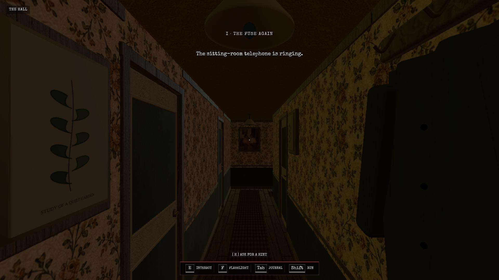
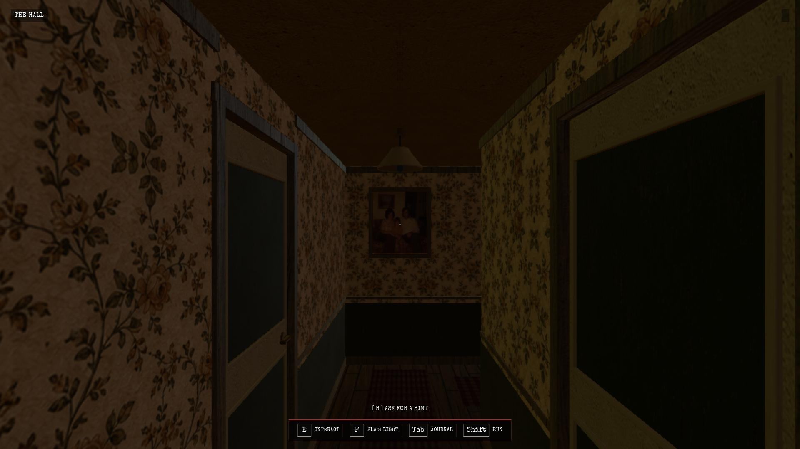
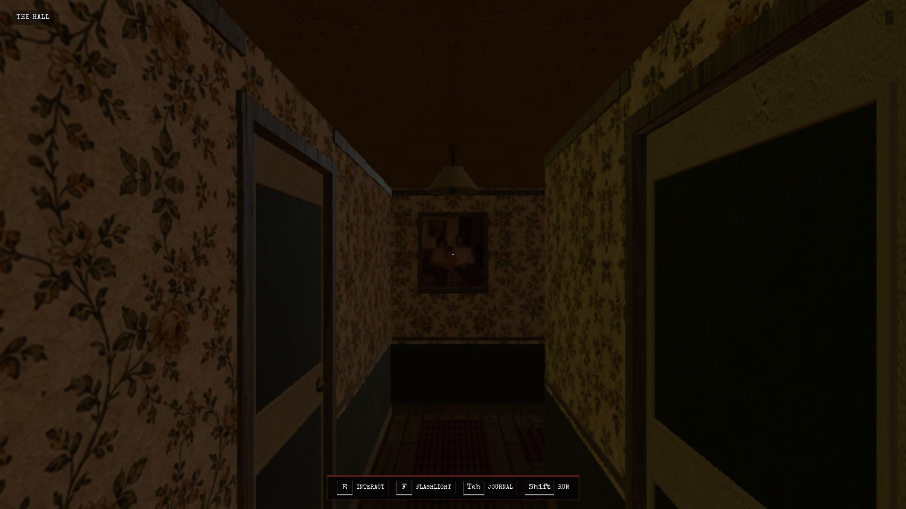

# MIRROR ME — measured rendering and input diagnosis

**Decision: stop the independent playtest. The environment sustains approximately 3 FPS at Performance 720p, and mouse-look remains unverified despite delivered relative input.**

This follow-up supersedes the initial Cloudflare report's statement that no hallway could be captured or movement verified. A hallway and forward displacement were subsequently captured. No puzzle, chapter transition, or ending was attempted. The original itch.io report remains unchanged.

## Controlled setup

Date: 2026-10-25. Measured session: approximately 08:41–08:42 UTC on https://mirror-me.pages.dev/. Release equivalence to itch.io remains unverified as documented in the separate Cloudflare report.

- Real headed Chromium, Xorg dummy display, 1920 × 1080 CSS viewport and fullscreen through the game UI.
- Performance 720p; actual game canvas backing dimensions **1280 × 720**.
- Film lighting off; contact shadows off; film grain off. Adaptive resolution enabled. Brightness remained 113%; walking motion was off by default. Scares and flickering lights were left enabled.
- Focus true, visibility `visible`, canvas pointer lock true, fullscreen true throughout measured inputs.
- Active backend: **ANGLE / Mesa llvmpipe**, LLVM 19.1.7, 256 bits, OpenGL 4.5 Core Profile, Mesa 25.0.7-2+deb13u1. This is CPU software rendering; no physical GPU device was available in `/dev/dri`.
- CPU resource limit: four cores; memory limit: 16 GiB. Observed available memory was ample; no out-of-memory event was established.

Prior browser-only troubleshooting tried SwiftShader and then explicit Mesa ANGLE with the GPU blocklist override. Disabling Chromium's GPU watchdog allowed longer operations without the earlier context-loss interruption. This does not create hardware acceleration. No additional backend or pixel-density experiment was attempted after the request for bounded measurement. No game source, deployed content, progression, or timers were changed.

## Measurement method

A passive `requestAnimationFrame` observer recorded timestamp intervals while the focused game was running in the starting hallway. A separate Chrome DevTools `Page.startScreencast` observer recorded compositor-frame metadata timestamps and acknowledged every frame. The screencast used 480 × 270 JPEG observation frames, quality 30. Full evidence captures used browser screenshots; no scene content was synthesized.

The measured window lasted **34.516 seconds**. It covered a roughly 10-second baseline, a sustained forward press, and a mouse-look attempt. It recorded **105 animation callbacks** and **102 compositor observations**. Statistics below exclude the first animation callback interval. These are browser scheduling/presentation observations, not instrumented engine simulation ticks or GPU timer queries. Compositor observations are screen updates, not proof that every WebGL render completed as a unique frame.

Capture/observation has overhead. There was no separate clean hardware baseline, so these values describe this instrumented environment. Independent earlier multi-second stalls and context failures support the practical usability limitation, but cannot be converted into a normal-hardware benchmark.

| Measure | Animation callback intervals | Compositor intervals |
| --- | ---: | ---: |
| Intervals measured | 104 | 101 |
| Mean | 328.67 ms | 334.85 ms |
| Median | 325.00 ms | 326.05 ms |
| 95th percentile | 400.00 ms | 427.36 ms |
| Maximum | 650.10 ms | 665.86 ms |
| Rate from mean interval | **3.04 Hz** | **2.99 Hz** |

The baseline before movement was already **3.12 Hz**, with a median interval of 316.6 ms. During the sustained forward phase it was **3.12 Hz**, median 300.05 ms. This is not simply a one-off input-time hitch. Typical intervals are roughly ten times a 30 FPS frame budget, with half-second stalls also observed.

## Input delivery and simulation

The passive DOM event observer recorded trusted browser input:

| Event | Browser performance timestamp | Observation |
| --- | ---: | --- |
| W keydown | 218689.6 ms | `isTrusted: true` |
| W keyup | 230699.3 ms | `isTrusted: true`; **12.010 seconds** held |
| First measured mousemove | 231899.7 ms | `movementX: 900`, `movementY: -174`, trusted |
| Bounded mouse follow-up | 289496.8 ms | `movementX: 60`, `movementY: 0`, trusted |

The first mouse delta was larger than intended because the preceding entry click left Playwright's absolute mouse position near the entry button. It is documented rather than treated as a valid fine-look test. A single smaller 60-pixel horizontal movement followed, with three seconds allowed before capture. No fabricated movement event, camera assignment, teleport, game-state injection, or scripted progression was used.

**Input delivery:** W down/up and both relative mouse events reached the document while focus, visibility, fullscreen, and lock were all confirmed. DOM receipt does not prove the application's specific handlers consumed each event, but it rules out complete browser input loss for these actions.

**Simulation:** forward input visibly changed the viewpoint along the hallway. The wall portrait and farther lamp grew larger; the near-left artwork and near-right mirror left the frame, and the near-right door occupied more of the view. The simulation is therefore **not completely frozen**, and forward input is acted on. Exact world distance and normal simulation speed cannot be established without a calibrated reference or reading/instrumenting game state. Neither was done. Real-time simulation correctness is unverified; low visual update frequency and poor responsiveness are established.

**Mouse-look:** neither the large first delta nor the bounded 60-pixel follow-up produced a clearly verified camera turn. The latter remained in the same hallway orientation after multiple expected frame opportunities. This cannot responsibly be explained solely by a missing input event: the event was delivered. The application's handling of pointer-locked automation/native input remains unresolved. No source-level cause or ordinary-hardware mouse bug is claimed.

**Rendering:** both independent timing observations cluster around three updates per second. This is independently sufficient to reject the environment for an interactive first-person horror review, regardless of the unresolved mouse-look behavior.

## Evidence

Before the measured forward input:



After the 12-second forward hold; landmarks show forward displacement:



After the bounded mouse-look follow-up; no clear camera turn established:



Additional captures include the fullscreen performance-mode menu, first successful hallway capture, the initial large-delta mouse test, and the working Escape pause menu. Pause visibly opened and released pointer lock in the prior retry; resume was not independently qualified as a full gameplay-control test.

## Bounded outcome

| Question | Supported answer |
| --- | --- |
| Can this environment render the hallway at a usable rate? | **No. Approximately 3 FPS** at 720p with expensive optional effects disabled |
| Are inputs entirely missing? | No; trusted keyboard and relative mouse events are recorded |
| Is the simulation entirely stopped? | No; forward movement visibly advances the viewpoint |
| Does simulation advance at its intended real-time speed? | Unverified without a calibrated reference; no normal-speed claim |
| Does mouse-look visibly work? | Not established, including after a bounded relative delta |
| Is this a demonstrated performance defect on normal gaming hardware? | No; all tested renderers are software backends |
| Is an independent playthrough supported? | No; stop before puzzle exploration |

No more backend experiments or gameplay attempts were made after this measurement. The appropriate next environment is hardware-backed headed Chromium with actual display and audio monitoring. No walkthrough, puzzle solution, chapter constants, automated route, or ending was consulted. Only the starting objective—answer the sitting-room telephone—was seen. No puzzle attempt, story reveal, creature encounter, funeral, or credits is claimed.

## Timing audit data

All 104 measured animation interval values in milliseconds (first callback excluded):

```text
366.7, 333.3, 300, 333.3, 300, 316.6, 300, 316.7, 283.3, 333.3, 300, 316.7, 299.9, 333.3, 300.1, 316.6, 283.3, 333.4, 283.3, 316.6, 283.3, 333.4, 349.9, 350.1, 316.6, 366.6, 316.7, 366.7, 316.6, 366.7, 316.6, 366.7, 349.9, 366.7, 350, 433.3, 583.3, 350, 316.7, 366.7, 299.9, 333.3, 300, 283.4, 299.9, 333.4, 299.9, 333.3, 266.7, 266.6, 266.7, 300, 283.4, 283.3, 266.6, 333.3, 266.7, 349.9, 300.1, 299.9, 250, 283.3, 250, 333.3, 650, 16.7, 583.3, 483.4, 66.6, 300, 300, 266.6, 250, 283.3, 266.7, 283.3, 400, 400, 316.6, 383.4, 349.9, 400, 333.3, 350.1, 333.3, 366.6, 333.3, 400, 366.7, 366.6, 333.3, 350.1, 349.9, 400, 349.9, 366.7, 316.7, 349.9, 316.7, 366.7, 316.6, 16.6, 650.1, 333.3
```

Raw telemetry remains locally available in `/workspace/cloudflare-playtest-evidence/persistent/frame-input-measurement.json`, with renderer metadata in `renderer.json` and the bounded mouse event in `small-look.json`. These local raw files are not included in the review commit, which contains Markdown and screenshots only.
